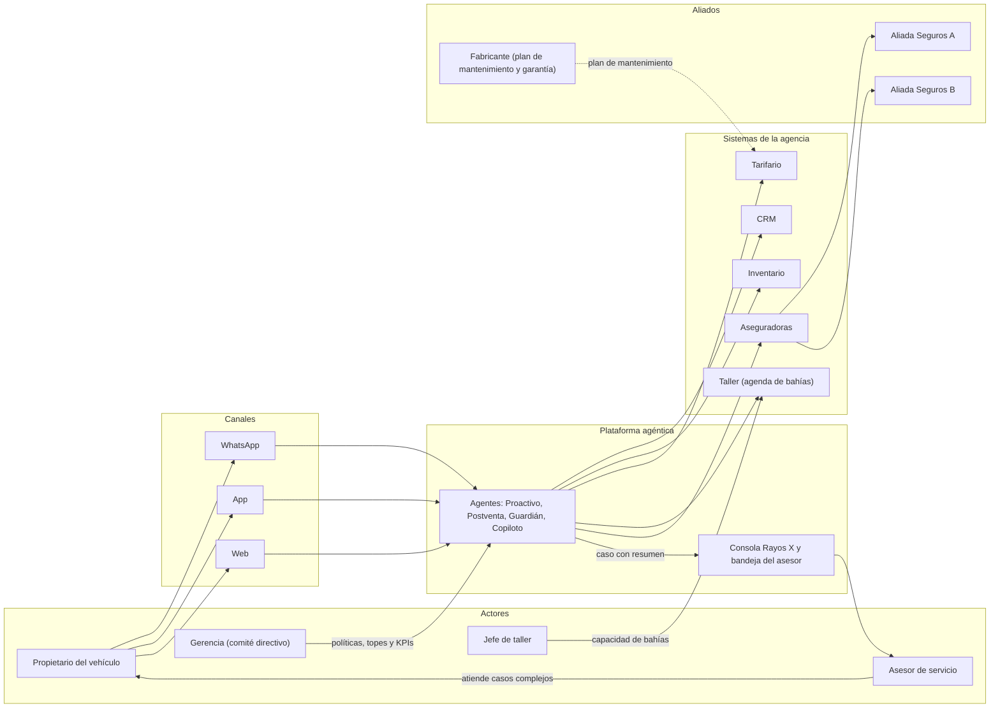
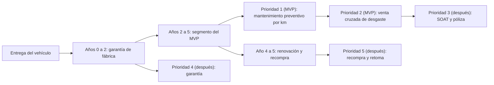
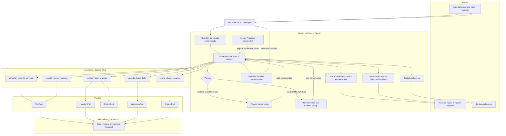
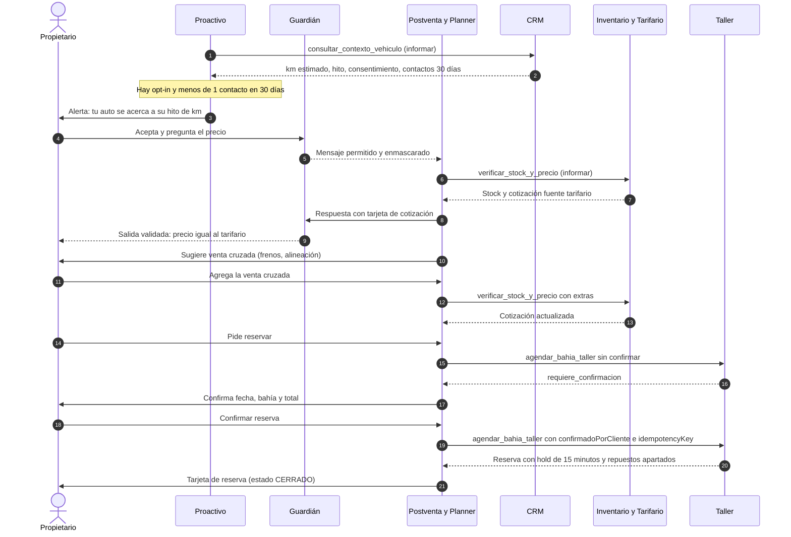
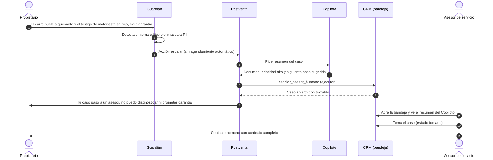
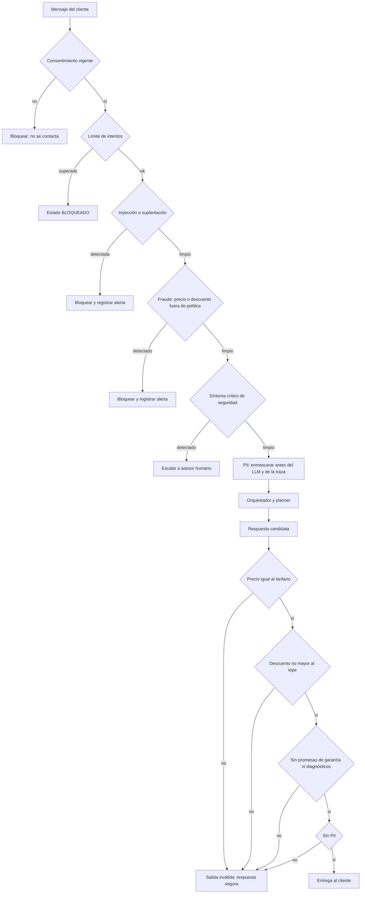
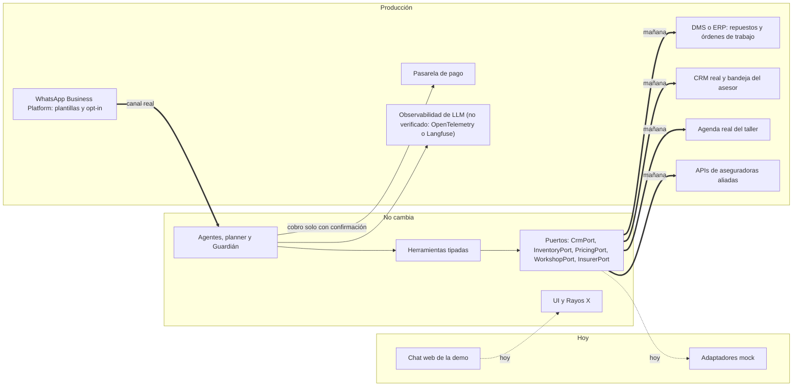
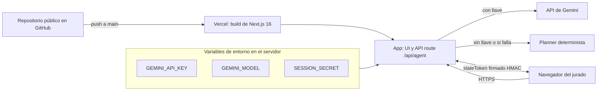

# Arquitectura y solución · Postventa agéntica

> Agencia automotriz multimarca (ficticia), mercado Colombia. Documento para un jurado técnico y de negocio.
> Versión 1.0 · 2026-11-11. Los nombres de agentes, herramientas, estados y sistemas coinciden con los contratos del código (`prototipo/src/core/contracts/` y `prototipo/src/core/ports/index.ts`).
> Las cifras financieras y de mercado no se repiten aquí: viven en `entregables/financial_summary.json` y `entregables/MODELO_FINANCIERO_POSTVENTA_3Y.xlsx` (modelo financiero) y en `docs/investigacion/FUENTES_MERCADO.md` (fuentes). Donde hace falta un número, este documento dice «ver modelo financiero».

## 0. Resumen en 30 segundos

- **Problema:** el día que se entrega el auto, la agencia pierde al cliente. Mantenimiento, seguros y recompra se van a talleres de barrio y aseguradoras externas, y las bahías del taller oficial quedan vacías.
- **Solución:** un sistema agéntico que actúa en el momento exacto del vehículo (kilometraje estimado), con consentimiento previo, consulta los sistemas reales de la agencia (CRM, Inventario, Tarifario, Taller, Aseguradoras) y pasa el caso a un humano cuando hay riesgo.
- **Principio rector:** no es un bot que manda más spam. Es un agente con herramientas tipadas, un Guardián determinista que el modelo de lenguaje no puede anular, y una consola «Rayos X» que hace visible cada paso.
- **MVP:** mantenimiento preventivo por kilometraje + venta cruzada (frenos, llantas, batería, alineación) para vehículos de 2 a 5 años.
- **Decisión de ingeniería clave:** el LLM entiende y redacta; precios, reservas, límites y seguridad los decide código determinista.

---

## 1. Ecosistema

Quién participa, por qué canales se habla y qué sistemas toca el agente.

**Usuarios priorizados** (BRD v1.1): 1) propietario del segmento años 2 a 5; 2) asesor de servicio; 3) jefe de taller (capacidad de bahías); 4) gerencia (decide y paga).

| Actor | Qué necesita | Qué recibe del sistema |
|---|---|---|
| Propietario | Aviso solo cuando su auto lo necesita, precio claro, reserva en 1 clic | Alerta por km, cotización cerrada, reserva con hold |
| Asesor de servicio | No responder lo repetitivo; recibir casos con contexto | Citas ya validadas y bandeja con resumen del Copiloto |
| Jefe de taller | Llenar bahías en horas valle | Reservas que privilegian franjas valle |
| Gerencia | Retención a 3 años sin ejército de call center | KPIs por capa y trazabilidad (sección 11) |

---

## 2. Ciclo de vida: de la entrega a la renovación

El producto cubre el ciclo completo, pero se construye por momentos y en orden de prioridad.

**Por qué este orden**

1. **Mantenimiento preventivo por km primero.** Es el punto de mayor fuga (el cliente se va al salir de garantía inicial), el dato que lo dispara es el más fiable (km estimado e historial) y llena bahías de forma recurrente.
2. **Venta cruzada en la misma visita.** Cuesta casi nada captarla cuando el cliente ya viene (frenos, llantas, batería, alineación) y sube el ticket sin otro contacto.
3. **SOAT y póliza después.** Dependen de integraciones con aseguradoras externas y de comisiones. En el prototipo ya existe la herramienta `cotizar_aliados_seguros` en nivel «recomendar», pero no es el foco del MVP.
4. **Garantía después.** Es el terreno de mayor riesgo legal: el agente tiene prohibido aprobar o prometer garantías, así que su primer papel es escalar bien.
5. **Recompra al final.** Necesita historial largo y datos de valoración que aún no existen; se hereda de la relación que construyen los pasos anteriores.

---

## 3. Arquitectura agéntica

Monolito modular en Next.js: una sola app con UI y API route, y un **núcleo puro** (`prototipo/src/core`) que no importa Next ni React y se prueba sin interfaz.

**Reglas que sostienen el diseño**

- **El planner nunca escribe precios ni reservas.** Devuelve qué tarjetas mostrar (`showCards`); el orquestador las arma con resultados de herramientas verificados.
- **Planner con respaldo.** Si no hay `GEMINI_API_KEY`, o Gemini falla (timeout, respuesta inválida), responde el planner determinista con el mismo contrato (`Planner`: `mode` = `deterministic` o `llm`). La demo no se cae.
- **Estados de la conversación:** `TRIGGER → CONTACTO → COTIZACION → VENTA_CRUZADA → CONFIRMACION → CERRADO`, con salidas `HANDOFF` y `BLOQUEADO`.
- **Trazas:** cada paso emite un `TraceEvent` (tipos `guardrail`, `tool_call`, `tool_result`, `policy`, `llm`, `handoff`, `state`, `memory`) con sistema, nivel de autonomía, latencia, estado y payload con PII enmascarada.
- **Memoria visible** por agente (`proactivo`, `postventa`, `guardian`, `copiloto`) en el panel «Memoria».

### 3.1 Agentes del producto

| Agente | Objetivo | Herramientas | Puede | Prohibido | Memoria |
|---|---|---|---|---|---|
| **Proactivo** (disparador) | Detectar el vehículo cerca de su hito de km | `consultar_contexto_vehiculo`, estimador de km, registro de consentimiento | Informar; proponer contacto si hay opt-in | Contactar sin opt-in; más de 1 contacto cada 30 días | Historial de contactos (CRM) |
| **Postventa** (conversacional; Gemini o determinista) | Resolver el mantenimiento en 1 clic | `verificar_stock_y_precio`, `agendar_bahia_taller`, `cotizar_aliados_seguros`, `escalar_asesor_humano` | Informar, recomendar, ejecutar reserva, apartar repuesto | Diagnosticar, aprobar garantías, dar descuento sobre el tope, cobrar sin confirmación, inventar precios | Sesión y perfil del vehículo |
| **Guardián** (determinista, sin LLM) | Seguridad y cumplimiento | Detectores de inyección, fraude, PII y síntomas críticos; validador de salida | Bloquear, enmascarar, escalar | Ser anulado por el LLM | Log de auditoría |
| **Copiloto del asesor** | Preparar el handoff | Resumen de caso | Resumir y sugerir siguiente paso | Hablar con el cliente o ejecutar | Caso abierto |

### 3.2 Herramientas, sistema y autonomía

| Herramienta | Sistema | Autonomía | Nota |
|---|---|---|---|
| `consultar_contexto_vehiculo` | CRM | informar | Perfil, consentimientos, km estimado, hito, garantía |
| `verificar_stock_y_precio` | Inventario (y Tarifario) | informar | Precio siempre del tarifario; descuento limitado por política |
| `agendar_bahia_taller` | Taller | ejecutar | Exige `confirmadoPorCliente` y `idempotencyKey` |
| `cotizar_aliados_seguros` | Aseguradoras | recomendar | Ofertas de aliados; el cliente decide |
| `escalar_asesor_humano` | CRM | ejecutar | Crea el caso en la bandeja con resumen |

---

## 4. Camino feliz

Alerta por km, cotización desde el tarifario, venta cruzada y reserva con hold de 15 minutos con confirmación del cliente.

Cada flecha hacia un sistema aparece como evento `tool_call` y `tool_result` en Rayos X, con latencia y nivel de autonomía.

---

## 5. Handoff por síntoma crítico

El agente no diagnostica ni promete garantía: frena y entrega el caso a una persona con todo el contexto.

El mismo patrón aplica a `sin_stock` (fecha alternativa y tarea al asesor), `adversarial`, `garantia` y `cliente_molesto` (los motivos de `HandoffCase`).

---

## 6. Tubería del Guardián

Es código determinista, sin LLM. El orden importa: lo más barato y más grave va primero.

Categorías del veredicto (`GuardrailVerdict`): `sin_consentimiento`, `limite_intentos`, `inyeccion`, `fraude`, `sintoma_critico`, `pii`, `salida_invalida`. Acciones posibles: `permitir`, `enmascarar`, `bloquear`, `escalar`. Cada decisión queda en la traza como evento `guardrail`.

---

## 7. Integración en producción

Hoy los puertos tienen adaptadores mock. En producción se cambian los adaptadores; el agente, las herramientas, el Guardián y la UI no cambian.

**Qué cambia:** los adaptadores (autenticación, mapeo de campos, errores y reintentos de cada sistema), el canal de entrada (WhatsApp Business Platform con plantillas aprobadas y registro de opt-in), la pasarela de pago y la observabilidad.
**Qué no cambia:** contratos Zod, herramientas, estados, Guardián, matriz de autonomía y consola de trazas.
**Posibles vías de salida** (ADR 0005): exponer las herramientas como servidor MCP o pasar la persistencia a Postgres sin tocar el agente, porque ya están detrás de puertos.

---

## 8. Despliegue

- **Sesión sin base de datos.** Cada petición puede caer en otra instancia de Vercel. La memoria de sesión (`SessionState`) viaja en un token firmado con HMAC y `SESSION_SECRET`; el servidor lo verifica en cada turno y no contiene PII sin enmascarar. Precios, stock y reglas se recalculan siempre en el servidor.
- **Llave en el servidor.** `GEMINI_API_KEY` nunca llega al navegador. `GEMINI_MODEL` elige el modelo (por defecto `gemini-3.5-flash-lite`; alternativa `gemini-3.6-flash`, ADR 0002).
- **Límites conocidos:** los datos son ficticios y viven en memoria (sin persistencia entre reinicios); el reloj de la demo es fijo (`DEMO_NOW`) para ser determinista; el token firmado limita el historial a 12 mensajes y 8000 caracteres; el nivel gratuito de Gemini usa los datos para mejorar productos de Google, válido para la demo con datos ficticios y no para producción.

---

## 9. Matriz de autonomía

| Acción | Nivel | Quién aprueba | Condición o tope |
|---|---|---|---|
| Consultar km estimado, historial y garantía | informar | Nadie (automático) | Solo con consentimiento y PII enmascarada |
| Informar precios y disponibilidad | informar | Nadie (automático) | Precio solo del tarifario |
| Recomendar paquete preventivo y venta cruzada | recomendar | El cliente | Sin presión; el cliente puede rechazar |
| Cotizar seguros de aliados | recomendar | El cliente | Ofertas de aliados; la póliza la emite la aseguradora |
| Reservar bahía con hold de 15 minutos | ejecutar | El cliente (confirmación explícita) | `confirmadoPorCliente` e `idempotencyKey`; el hold vence solo |
| Apartar repuesto | ejecutar | Implícita en la reserva confirmada | Solo los SKU de la cotización |
| Escalar a asesor humano | ejecutar | El asesor toma el caso | Obligatorio ante síntoma crítico, sin stock, adversarial, garantía o cliente molesto |
| Diagnosticar averías | prohibido | Asesor y taller | El agente no emite diagnósticos |
| Aprobar o prometer garantía | prohibido | Asesor con el fabricante | Solo se escala |
| Descuento sobre el tope | prohibido | Gerencia de postventa | Tope en `data/assumptions.json` (`tope_descuento_pct`) |
| Cobrar sin confirmación | prohibido | No existe aprobación posible | Siempre confirmación explícita |
| Contactar sin opt-in o más de 1 vez cada 30 días | prohibido | No existe aprobación posible | `max_contactos_30_dias` en la política |
| Inventar precios | prohibido | No existe aprobación posible | El validador de salida bloquea |

---

## 10. Controles

| Control | Qué hace | Dónde vive |
|---|---|---|
| **Privacidad y Ley 1581 de 2012** | Minimización de datos y finalidad declarada por consentimiento. La PII se enmascara antes del LLM, de la traza y del token de sesión. La ley colombiana de protección de datos personales fue mencionada en el BRD; su alcance exacto se valida con el área jurídica (no verificado aquí) | Guardián (`pii`) y `Consent.finalidad` |
| **Consentimiento** | Sin `optIn` vigente para el canal no hay contacto; máximo 1 contacto cada 30 días | Proactivo y Guardián (`sin_consentimiento`) |
| **Calidad** | Evals pasa/no pasa sobre casos reales y adversariales, con reporte por categoría y meta de 100 % en seguridad | `prototipo/evals/REPORTE_EVALS.md` |
| **Trazabilidad** | Cada turno tiene `turnId` y una lista de `TraceEvent` con sistema, autonomía, latencia y estado; los casos de handoff guardan `trazaIds` | Rayos X y log de auditoría |
| **Fraude** | Descuento y precio fuera de política se bloquean; reservas idempotentes; verificación del cliente antes de ejecutar; límite de intentos que lleva a `BLOQUEADO` | Guardián (`fraude`, `limite_intentos`) y herramientas |
| **Adversarial** | Detección de inyección y suplantación («actúa como el gerente»); no se expone el system prompt; el LLM no puede anular al Guardián (ADR 0004) | Guardián (`inyeccion`) |
| **Escalamiento** | Cinco motivos de handoff (`HandoffReason`) con prioridad y siguiente paso sugerido; el Copiloto resume pero no habla con el cliente | `escalar_asesor_humano`, Copiloto |

---

## 11. KPIs por capa

Las metas numéricas salen del modelo financiero (ver modelo financiero); aquí se fija qué se mide y de dónde sale el dato.

| Capa | KPI | Definición | Fuente del dato |
|---|---|---|---|
| Experiencia | Tiempo hasta reserva confirmada | Minutos entre la alerta y la confirmación | Trazas (`turnId` y eventos de estado) |
| Experiencia | Satisfacción tras el servicio | Encuesta corta de 1 a 5 después de la visita | CRM |
| Adopción | Tasa de respuesta a la alerta | Respuestas / alertas enviadas | Trazas y WhatsApp Business |
| Adopción | Conversión a reserva | Reservas confirmadas / alertas respondidas | Taller (`Booking`) |
| Adopción | Tasa de opt-in | Clientes con opt-in activo / parque activo | CRM (`Consent`) |
| Calidad del agente | Acierto en evals | Casos pasa / total, por categoría | `REPORTE_EVALS.md` |
| Calidad del agente | Bloqueos de salida | Respuestas bloqueadas por el Guardián de salida / respuestas | Trazas (`salida_invalida`) |
| Calidad del agente | Precio distinto del tarifario | Cotizaciones con diferencia / cotizaciones (meta: 0) | Trazas y Tarifario |
| Operación | Ocupación de bahías en valle | Franjas valle reservadas / franjas valle ofrecidas | Taller |
| Operación | Tasa de escalamiento y tiempo de toma | Casos escalados / conversaciones; minutos hasta `tomado` | Bandeja del asesor |
| Operación | No-show | Reservas no atendidas / reservas | Taller |
| Margen | Margen incremental por visita | Margen de la visita agendada por el agente menos costo de IA y canal | Modelo financiero y DMS |
| Margen | Costo de IA por conversación | Costo de tokens y canal / conversaciones | Trazas (`usage`) |
| Fidelización | Retención en taller oficial | Vehículos del segmento que vuelven al taller / segmento | CRM y DMS |
| Fidelización | Visitas por vehículo al año | Visitas al taller oficial / vehículos activos | DMS |

---

## 12. Cambio en el trabajo del asesor y gobierno

**Qué cambia para el asesor.** Deja de contestar por WhatsApp preguntas repetitivas (precio, disponibilidad, horario). Recibe citas ya confirmadas y casos con contexto: motivo, prioridad, resumen del Copiloto, km estimado, síntomas y siguiente paso sugerido. Su tiempo se va a garantías, síntomas de seguridad, falta de stock y clientes molestos.

**Gobierno del agente**

| Qué | Quién | Cada cuánto | Cómo |
|---|---|---|---|
| Revisión de trazas de casos escalados y bloqueos | Jefe de servicio con un asesor | Semanal al inicio; luego quincenal | Rayos X y log de auditoría; los falsos positivos y negativos pasan a evals |
| Revisión de KPIs de calidad y margen | Gerencia de postventa | Mensual | Tablero de KPIs de la sección 11 |
| Cambio de política (tope de descuento, límite de contactos, hold) | Gerencia | Cuando haga falta, con registro | Se edita `data/assumptions.json` (fuente única, ADR 0003) |
| Cambio de prompt, modelo o recuperación | Responsable técnico del agente | Por cambio | Se mide con evals antes y después: el cambio solo entra si no baja el acierto y sostiene 100 % en seguridad |
| Reglas del Guardián | Responsable técnico y seguridad | Por cambio | Pruebas unitarias nuevas por cada caso nuevo; revisión de código |

Para cambiar un prompt: 1) escribir el caso que falla como eval; 2) cambiar el prompt; 3) correr `npm run evals`; 4) comparar con el reporte anterior; 5) desplegar solo si pasa.

---

## 13. Riesgos y mitigaciones

| Riesgo | Efecto | Mitigación |
|---|---|---|
| El LLM inventa un precio o promete una garantía | Pérdida económica o reclamo | El planner no escribe precios; el Guardián de salida compara con el tarifario y bloquea promesas |
| Inyección de instrucciones o suplantación | Descuentos o datos indebidos | Guardián determinista previo al LLM; el LLM no puede anularlo; límite de intentos |
| Contacto sin consentimiento o exceso de mensajes | Sanción y daño de marca | Opt-in obligatorio, máximo 1 contacto cada 30 días, canal con plantillas aprobadas |
| Fuga de PII en logs o prompts | Incumplimiento legal | Enmascaramiento antes del LLM, de la traza y del token; el token no lleva PII |
| Km estimado equivocado | Alerta fuera de tiempo | El estimador usa historial y ritmo de uso; se mide el error del estimador contra el km real en cada visita |
| Sin stock o taller saturado | Cliente molesto | Se verifica stock antes de cotizar; si falta, fecha alternativa y tarea al asesor; hold que vence solo |
| Caída o lentitud de Gemini | Demo o servicio caído | Timeout, un reintento y planner determinista con el mismo contrato |
| Cambio de precios del modelo de IA | Costo mayor al previsto | Costo por conversación como supuesto con rango; ver modelo financiero |
| Supuestos de negocio sin validar | Caso de negocio débil | Cada supuesto con fuente o marcado como propio, con plan de validación; ver `docs/investigacion/FUENTES_MERCADO.md` |
| Integración real más difícil que el mock | Retraso | Puertos estables; piloto con un sistema a la vez; ver roadmap del resumen ejecutivo |
| El asesor no adopta la bandeja | Casos sin atender | Medir tiempo hasta `tomado`; involucrar al jefe de servicio en la revisión semanal |

---

## 14. Matriz de pruebas

> Estructura lista; la completa la tarea T15 con evidencia (comando y resultado).

| Área | Qué se prueba | Comando o herramienta | Casos | Resultado | Evidencia |
|---|---|---|---|---|---|
| Contratos | Esquemas Zod de dominio, agente y herramientas | | | | |
| Herramientas y adaptadores | Cinco herramientas contra adaptadores mock | | | | |
| Guardián de entrada | Consentimiento, intentos, inyección, fraude, síntoma, PII | | | | |
| Guardián de salida | Precio, descuento, garantía, diagnóstico, PII | | | | |
| Planner determinista | Camino feliz y excepciones | | | | |
| Planner Gemini | Function calling y respaldo determinista | | | | |
| Evals | Acierto por categoría y modelo | | | | |
| API | Los 5 escenarios por `POST /api/agent` | | | | |
| UI | Propietario, Rayos X, Memoria y bandeja | | | | |
| E2E | 5 escenarios en navegador, 0 errores de consola | | | | |
| Coherencia | Supuestos iguales en app, Excel y PDF | | | | |

---

## 15. Qué no hacemos hoy y por qué

Cada decisión tiene un disparador concreto que la haría cambiar (detalle en ADR 0005).

| No usamos hoy | Por qué | Disparador para cambiar |
|---|---|---|
| MCP | Las herramientas viven en el mismo proceso y no hay segundo cliente que las consuma | Otro agente o sistema externo necesita las mismas herramientas |
| RAG | Los datos son estructurados (tarifario, inventario, historial) y se consultan de forma determinista | Aparece contenido no estructurado grande (manuales, políticas) que el agente deba citar |
| Supabase o base de datos | La sesión viaja en un token firmado y los datos son ficticios | Hace falta persistir conversaciones, casos o auditoría entre sesiones y dispositivos |
| Railway | Vercel sirve UI y API; no hay procesos de larga duración | Aparecen tareas de larga duración, colas o trabajos programados |
| Fine-tuning | Prompts, herramientas y Guardián bastan y se miden con evals | Los evals muestran una brecha de calidad que el prompt no cierra con datos reales suficientes |
| LangChain | Se usa el SDK oficial de Gemini directo; menos capas y más control del contrato | Se necesitan varios proveedores de modelos con un grafo de agentes complejo |

También queda fuera del prototipo: integración real con DMS, CRM, WhatsApp y aseguradoras (se documenta en la sección 7), cobro real, telemetría OBD2 y recompra (fases posteriores del BRD).

---

## 16. Registro de decisiones (ADR)

Índice en `docs/adr/README.md`: 0001 stack, 0002 agente híbrido con Gemini, 0003 fuente única de supuestos, 0004 Guardián determinista, 0005 qué no usamos hoy.
