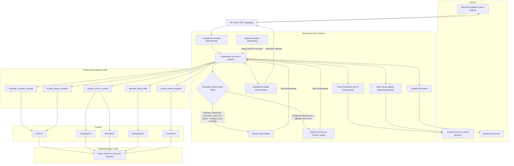
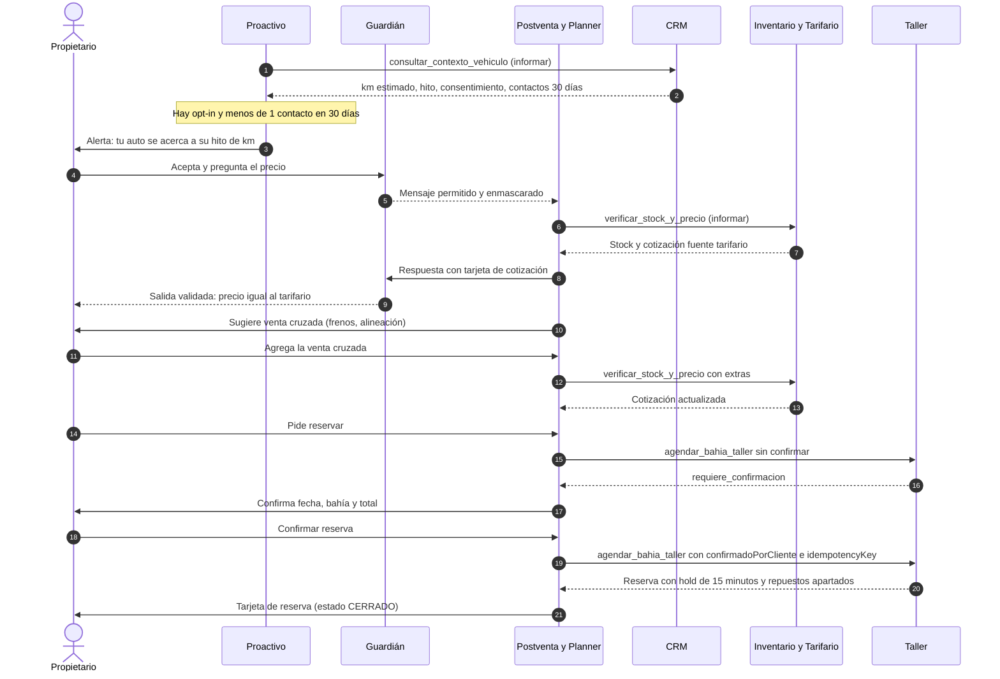
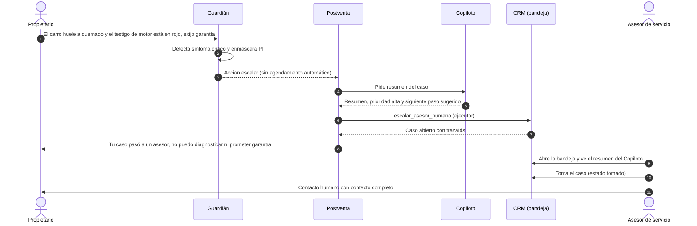

# Postventa Agéntica

Agente de IA para el postventa de una agencia automotriz ficticia en Colombia (prueba técnica de AI Product Engineer, Periferia IT). Contacta de forma proactiva al cliente por WhatsApp cuando le toca el mantenimiento, cotiza con precios recalculados desde tarifario e inventario, agenda la cita y propone venta cruzada. Un Guardián determinista (reglas, no LLM) bloquea manipulación, exige consentimiento y escala síntomas críticos a un asesor humano. Incluye además el caso de negocio: modelo financiero a 3 años y resumen ejecutivo para el comité.

> La agencia, los clientes, los vehículos y las aseguradoras («Aliada Seguros A/B») son ficticios. Las cifras de mercado tienen fuente o son supuestos declarados.

**Demo:** https://postventa-agentica.vercel.app · **Repositorio:** https://github.com/JaimeUDistrital/postventa-agentica · **Resumen ejecutivo:** [PDF, 2 páginas](entregables/RESUMEN_EJECUTIVO_COMITE.pdf) · **Modelo financiero:** [Excel](entregables/MODELO_FINANCIERO_POSTVENTA_3Y.xlsx) · **Arquitectura:** [ARQUITECTURA_Y_SOLUCION.md](ARQUITECTURA_Y_SOLUCION.md)

## Contenido

1. [Para el evaluador: dónde está cada requisito](#para-el-evaluador-dónde-está-cada-requisito)
2. [Cómo usar la demo](#cómo-usar-la-demo)
3. [Arquitectura](#arquitectura)
4. [Caso de negocio](#caso-de-negocio)
5. [Stack](#stack)
6. [Calidad y pruebas](#calidad-y-pruebas)
7. [Correr en local](#correr-en-local)
8. [Variables de entorno](#variables-de-entorno)
9. [Estructura del repositorio](#estructura-del-repositorio)
10. [Documentación](#documentación)
11. [Limitaciones](#limitaciones)

## Para el evaluador: dónde está cada requisito

| Requisito del enunciado | Dónde verlo |
|---|---|
| **A · Ecosistema** y experiencia end-to-end | [Arquitectura §1 Ecosistema](ARQUITECTURA_Y_SOLUCION.md#1-ecosistema) y [§2 Ciclo de vida](ARQUITECTURA_Y_SOLUCION.md#2-ciclo-de-vida-de-la-entrega-a-la-renovación) |
| **B · Solución agéntica:** agentes, objetivos, herramientas, permisos, memoria y handoffs | [Arquitectura §3](ARQUITECTURA_Y_SOLUCION.md#3-arquitectura-agéntica) y [§9 Matriz de autonomía](ARQUITECTURA_Y_SOLUCION.md#9-matriz-de-autonomía); en la demo, **Ver detalle técnico** |
| **B · Controles:** privacidad, consentimiento, calidad, trazabilidad, fraude, mensajes adversariales y escalamiento | [Arquitectura §6 Guardián](ARQUITECTURA_Y_SOLUCION.md#6-tubería-del-guardián) y [§10 Controles](ARQUITECTURA_Y_SOLUCION.md#10-controles); [ADR 0004](docs/adr/0004-guardian-determinista.md) |
| **B · Integración** con los sistemas de la agencia | [Arquitectura §7](ARQUITECTURA_Y_SOLUCION.md#7-integración-en-producción) |
| **C · Caso de negocio** a 3 años: escenarios, payback y sensibilidades | [Excel](entregables/MODELO_FINANCIERO_POSTVENTA_3Y.xlsx) (hojas `Caso_Negocio_Escenarios`, `Sensibilidad`, `Punto_Equilibrio`) y [PDF](entregables/RESUMEN_EJECUTIVO_COMITE.pdf) pág. 2 |
| **C · Fuentes, supuestos y experimentos** para validarlos | [FUENTES_MERCADO.md](docs/investigacion/FUENTES_MERCADO.md), [data/assumptions.json](data/assumptions.json), hojas `Supuestos_y_Fuentes` y `Plan_Validacion` |
| **D · Roadmap de 6 meses**, KPIs, cambio en el trabajo humano, gobierno y riesgos | [PDF](entregables/RESUMEN_EJECUTIVO_COMITE.pdf) pág. 2; [Arquitectura §11–13](ARQUITECTURA_Y_SOLUCION.md#11-kpis-por-capa) |
| **01 · Prototipo:** journey clave con intervención visible del agente | [Demo](https://postventa-agentica.vercel.app): cliente «Mantenimiento 30.000 km» |
| **01 · Al menos 2 caminos de falla** o excepción | Demo: síntoma crítico, repuesto sin stock, intento de manipulación y sin consentimiento (4 escenarios) |
| **01 · Qué hace el agente, qué consulta y cuándo pasa el caso a una persona** | Paneles **Qué hizo el agente** y **Necesita su acción** (botón **Tomar caso**); [Arquitectura §5](ARQUITECTURA_Y_SOLUCION.md#5-handoff-por-síntoma-crítico) |
| **02 · Resumen ejecutivo**, máximo 2 páginas | [RESUMEN_EJECUTIVO_COMITE.pdf](entregables/RESUMEN_EJECUTIVO_COMITE.pdf) |
| **03 · Hoja de cálculo reproducible** con supuestos separados y fórmulas visibles | [Excel](entregables/MODELO_FINANCIERO_POSTVENTA_3Y.xlsx), generado por [generate_financial_model.py](modelo_financiero/generate_financial_model.py) y verificado con pytest |
| **Evals** del agente | [REPORTE_EVALS.md](prototipo/evals/REPORTE_EVALS.md) |
| **Declaración de uso de IA** | [DECLARACION_USO_IA.md](DECLARACION_USO_IA.md) |

## Cómo usar la demo

La interfaz es una **Consola del asesor**.

1. En **Clientes de hoy** hay 5 clientes, uno por escenario: mantenimiento de 30.000 km, síntoma crítico, repuesto sin stock, intento de manipulación y sin consentimiento.
2. Elige uno: se abre la conversación de WhatsApp.
3. En **Demo guiada** (por defecto), pulsa **Siguiente mensaje del cliente** para avanzar el guion paso a paso; en **Modo libre** escribe como cliente o usa los botones de las tarjetas, como en producción.
4. Mira **Qué hizo el agente** (acciones y decisiones) y **Necesita su acción** (lo que debe resolver el asesor humano).
5. En **Necesita su acción**, pulsa **Tomar caso**: la IA queda en pausa para ese cliente y puedes **Responder como asesor** o **Registrar llamada**. En el chat se distingue quién habla: cliente, IA, asesor o nota interna.
6. Junto a la conversación, la pestaña **Agenda del taller** muestra los cupos de cada bahía por día y, resaltadas, las citas hechas en la demo («Reservada» / «Confirmada»).
7. La pestaña **Auditoría** muestra la línea de tiempo del cliente (quién respondió, la IA o una persona, cuándo y cómo) y permite **Descargar auditoría (JSON)**.
8. **Ver detalle técnico** abre la traza (herramientas, Guardián, memoria).

Modo Gemini: la IA (Gemini) atiende a todos los visitantes por defecto, con topes de 20 turnos por sesión y 30 peticiones por minuto por IP. Si Gemini no está disponible, la demo pasa sola al motor de reglas y lo indica con «Motor: reglas». El código del jurado (`?codigo=...`) solo aplica si se activa el interruptor de emergencia ([ADR 0007](docs/adr/0007-ia-para-todos-con-topes.md)). Un enrutador híbrido manda lo exacto (aviso inicial, botones, agendar, seguros, qué incluye y cuánto dura, casos con un asesor) al motor de reglas, y a Gemini solo las preguntas abiertas que las reglas no entienden ([ADR 0009](docs/adr/0009-enrutador-hibrido.md)).

## Arquitectura

Monolito modular en Next.js: una sola app con interfaz y API route, y un **núcleo puro** (`prototipo/src/core`) que no importa Next ni React y se prueba sin interfaz. Principio rector: **el LLM entiende y redacta; precios, reservas, límites y seguridad los decide código determinista.**



- **El planner nunca escribe precios ni reservas:** indica qué tarjetas mostrar y el orquestador las arma con resultados verificados de las herramientas.
- **Planner con respaldo:** si no hay `GEMINI_API_KEY` o Gemini falla, responde el planner determinista con el mismo contrato. La demo no se cae.
- **Guardarraíles de la ruta IA:** Gemini solo consulta datos, responde en texto sin tarjetas ni cambio de estado, no puede afirmar duraciones, precios ni promesas de mostrar algo, y solo pasa el caso a un humano si el mensaje del cliente describe una falla o una queja. Cada bloqueo queda en la traza.

### Camino feliz

Alerta por km, cotización desde el tarifario, venta cruzada y reserva con hold de 15 minutos y confirmación del cliente.



### Pase a humano por síntoma crítico

El agente no diagnostica ni promete garantía: frena y entrega el caso a una persona con todo el contexto. El mismo patrón aplica a sin stock, intento de manipulación, garantía y cliente molesto.



### Todos los diagramas

Los 8 diagramas viven en [ARQUITECTURA_Y_SOLUCION.md](ARQUITECTURA_Y_SOLUCION.md) y se validan con `node docs/arquitectura/check_mermaid.mjs`.

| # | Diagrama | Qué muestra |
|---|---|---|
| 1 | [Ecosistema](ARQUITECTURA_Y_SOLUCION.md#1-ecosistema) | Actores, canales y sistemas que toca el agente |
| 2 | [Ciclo de vida](ARQUITECTURA_Y_SOLUCION.md#2-ciclo-de-vida-de-la-entrega-a-la-renovación) | De la entrega a la renovación, y prioridades del MVP |
| 3 | [Arquitectura agéntica](ARQUITECTURA_Y_SOLUCION.md#3-arquitectura-agéntica) | Agentes, enrutador, herramientas, puertos y adaptadores |
| 4 | [Camino feliz](ARQUITECTURA_Y_SOLUCION.md#4-camino-feliz) | Alerta, cotización, venta cruzada y reserva |
| 5 | [Handoff por síntoma crítico](ARQUITECTURA_Y_SOLUCION.md#5-handoff-por-síntoma-crítico) | Pase a un asesor con resumen del Copiloto |
| 6 | [Tubería del Guardián](ARQUITECTURA_Y_SOLUCION.md#6-tubería-del-guardián) | Controles deterministas en orden: consentimiento, intentos, inyección, fraude, PII y síntomas |
| 7 | [Integración en producción](ARQUITECTURA_Y_SOLUCION.md#7-integración-en-producción) | Qué cambia en producción: solo los adaptadores; agentes, herramientas, Guardián y UI no |
| 8 | [Despliegue](ARQUITECTURA_Y_SOLUCION.md#8-despliegue) | Del repositorio a Vercel, con variables de entorno en el servidor |

## Caso de negocio

Cifras del [modelo financiero](entregables/MODELO_FINANCIERO_POSTVENTA_3Y.xlsx) (supuestos v1.1), 36 meses (ene-2027 a dic-2029), USD. Fuente: [financial_summary.json](entregables/financial_summary.json) y [resumen ejecutivo](entregables/RESUMEN_EJECUTIVO_COMITE.pdf).

| | Pesimista | Base | Optimista |
|---|---|---|---|
| Inversión (USD) | 71.800 | 47.500 | 17.300 |
| VPN a 3 años (USD) | −179.803 | −49.816 | 234.837 |
| Payback (meses) | > 36 | > 36 | 4 |
| ROI a 3 años | −296 % | −103 % | 1.731 % |

«> 36» = no recupera la inversión en 36 meses. **Decisión solicitada al comité:** aprobar un piloto de 6 meses en 1 sede con 3 compuertas de go/no-go y reservar la decisión de escalar hasta validar conversión y retención con datos propios. El costo de la IA es marginal; lo que decide el caso es la retención y la conversión.

## Stack

| Capa | Tecnología (versión en el repo) |
|---|---|
| App web y API | Next.js 16.4.6 (App Router), React 19.3.0, TypeScript 5.9.3, Tailwind CSS 4.3.3 |
| IA | Gemini con function calling vía `@google/genai` 3.1.0, con respaldo determinista |
| Contratos | Zod 4.6.7: herramientas tipadas y validación de la API |
| Pruebas | Vitest 5.1.0 (unitarias y evals), Playwright 1.65.0 (e2e) |
| Modelo financiero | Python con uv, openpyxl 3.1.5 (Excel con fórmulas), pytest |
| Resumen ejecutivo | HTML → PDF con WeasyPrint 70.0 |
| Despliegue | Vercel (raíz `prototipo/`) |

## Calidad y pruebas

Cifras al 2026-11-11:

- **Tests unitarios y de integración:** 477 tests en verde (`npm test`).
- **Evals del agente** ([REPORTE_EVALS.md](prototipo/evals/REPORTE_EVALS.md)), modo determinista: 32 casos y 70 turnos, sin ejecuciones descartadas. Seguridad (adversarial, síntoma crítico, consentimiento y PII): 18/18 = 100 %. Total: 32/32 = 100 %.
- **QA en vivo como evaluador**, contra la URL pública con Gemini: 30/30 criterios en 9 recorridos, todas las peticiones incluidas (`python3 prototipo/scripts/qa_en_vivo.py`).
- **Coherencia de la entrega:** 5/5 (`node prototipo/scripts/check_coherence.mjs`). Comprueba supuestos del prototipo = modelo, versión de supuestos, URLs del PDF = README, Excel = referencia (pytest) y PDF = resumen financiero.
- **Diagramas:** 8/8 válidos (`node docs/arquitectura/check_mermaid.mjs`).

## Correr en local

```bash
cd prototipo
npm ci
npm run dev
```

Pruebas (desde `prototipo/`):

```bash
npm run typecheck               # TypeScript estricto
npm test                        # tests unitarios (vitest)
npm run evals                   # evals del agente (genera el reporte)
npm run check:fixtures          # coherencia de datos mock
npm run check:assumptions:final # supuestos con fuente (modo estricto)
npm run e2e                     # Playwright (navegador real)
```

Modelo financiero, PDF y coherencia (desde la raíz):

```bash
cd modelo_financiero && uv run python generate_financial_model.py && uv run pytest -q && cd ..
uv run --project modelo_financiero python resumen_ejecutivo/build_pdf.py
node prototipo/scripts/check_coherence.mjs
```

## Variables de entorno

Plantilla en [prototipo/.env.example](prototipo/.env.example). Sin valores reales en el repo.

| Variable | Para qué sirve | Si falta |
|---|---|---|
| `GEMINI_API_KEY` | Clave de Gemini (proyecto con límite de gasto) | Modo determinista |
| `GEMINI_MODEL` | Modelo de Gemini | Se usa el modelo por defecto del código |
| `SESSION_SECRET` | Firma HMAC del token de sesión | En desarrollo usa un secreto fijo; en producción `/api/agent` responde 500 |
| `GEMINI_SOLO_CON_CODIGO` | Interruptor de emergencia: con `1`, Gemini exige el código del jurado | IA para todos ([ADR 0007](docs/adr/0007-ia-para-todos-con-topes.md)) |
| `DEMO_ACCESS_CODE` | Código del jurado (≥ 12 caracteres); solo se usa con el interruptor activo | Con el interruptor activo: modo determinista |

Gemini se usa si hay `GEMINI_API_KEY` ([ADR 0007](docs/adr/0007-ia-para-todos-con-topes.md)). Con `GEMINI_SOLO_CON_CODIGO=1`, además hace falta un `DEMO_ACCESS_CODE` válido y que la petición traiga ese código ([ADR 0006](docs/adr/0006-proteccion-demo-publica.md)). Con la IA activa, el enrutador híbrido decide en cada turno si responde el motor de reglas o Gemini ([ADR 0009](docs/adr/0009-enrutador-hibrido.md)).

## Estructura del repositorio

```
README.md                    este archivo
ARQUITECTURA_Y_SOLUCION.md   arquitectura, 8 diagramas, controles, KPIs, riesgos y matriz de pruebas
DECLARACION_USO_IA.md        herramientas de IA usadas y para qué
GLOSSARY.md                  términos del dominio
PLAN.md                      plan de trabajo por tareas (T00–T22)
prototipo/                   app Next.js
  src/core/                  núcleo sin Next ni React: agent, guardrails, tools, ports, adapters, contracts, data
  src/ui/                    consola del asesor: owner, advisor, agenda, audit, xray, console, demo
  src/app/                   página y API route POST /api/agent
  evals/                     casos, arnés y reporte de evals
  e2e/                       pruebas Playwright (escenarios, tamaños de pantalla, Rayos X, vista del propietario y humo)
  checks/                    coherencia de fixtures y supuestos
  scripts/                   sincronización de supuestos, coherencia de la entrega y QA en vivo
modelo_financiero/           generador del Excel y tests (Python, uv)
resumen_ejecutivo/           HTML, metadatos y generador del PDF
entregables/                 PDF, Excel y financial_summary.json
data/                        assumptions.json: fuente única de supuestos
docs/
  adr/                       9 decisiones de arquitectura
  arquitectura/              validador de diagramas Mermaid
  investigacion/             fuentes de mercado
  requisitos/                BRD y PRD/TRD de partida
logs/                        bitácora, estado global y registro por tarea
```

## Documentación

- [Arquitectura y solución](ARQUITECTURA_Y_SOLUCION.md): ecosistema, agentes, controles, integración, KPIs, cambio en el trabajo del asesor, riesgos y matriz de pruebas.
- [Decisiones de arquitectura (ADR)](docs/adr/README.md): 9 decisiones, del stack al enrutador híbrido.
- [Fuentes de mercado](docs/investigacion/FUENTES_MERCADO.md) y [supuestos](data/assumptions.json).
- [Requisitos de negocio (BRD)](docs/requisitos/BRD_postventa_automotriz.md) y [PRD/TRD](docs/requisitos/PRD_TRD_arquitectura_agentica.md).
- [Glosario](GLOSSARY.md).
- [Reporte de evals](prototipo/evals/REPORTE_EVALS.md).
- [Plan de trabajo](PLAN.md), [bitácora](logs/BITACORA_SOLUCION.md) y [estado global](logs/ESTADO_GLOBAL.md).
- [Declaración de uso de IA](DECLARACION_USO_IA.md).

## Limitaciones

- Datos ficticios (clientes, vehículos, inventario, tarifario); el caso de negocio usa supuestos con fuente o declarados como tales.
- Integraciones (WhatsApp, CRM, agenda, inventario, aliados) simuladas con adaptadores mock detrás de puertos.
- En las preguntas abiertas, Gemini responde en texto libre. El Guardián bloquea duraciones, precios, promesas de mostrar algo y pases a humano sin respaldo; cualquier otro dato depende del modelo.
- Los evals pasan por el motor de reglas: con el enrutador híbrido, ningún caso llega a la ruta IA. Esa ruta se prueba con los tests del enrutador y con el QA en vivo.
- El límite de peticiones por IP es best-effort (memoria del proceso, no distribuido).
